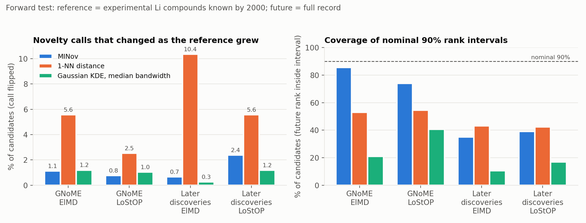
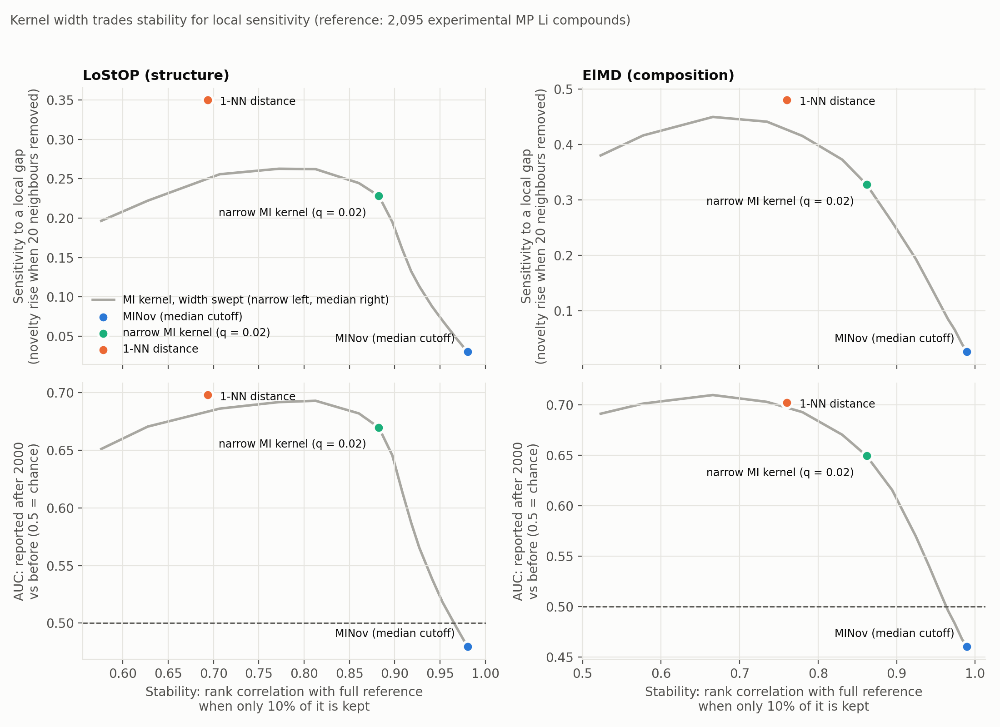
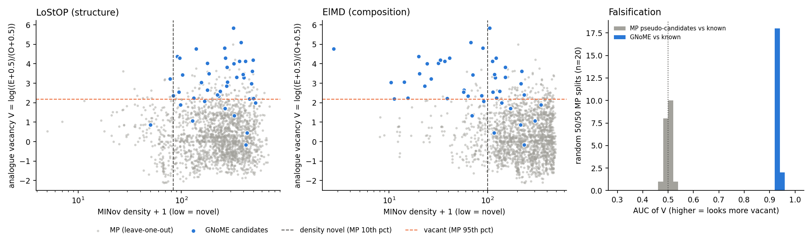
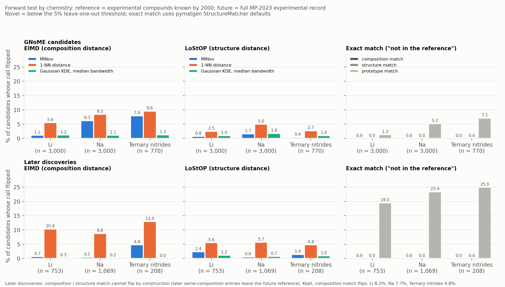
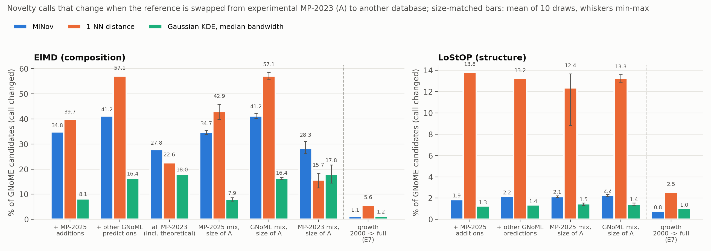
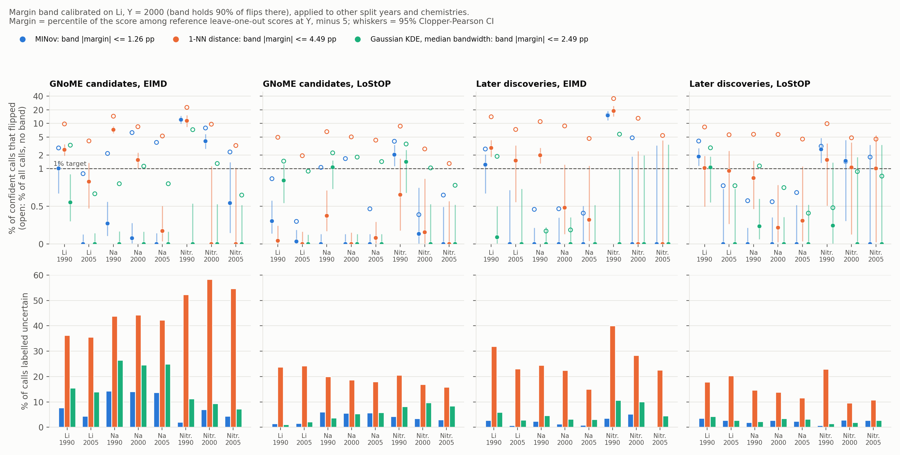
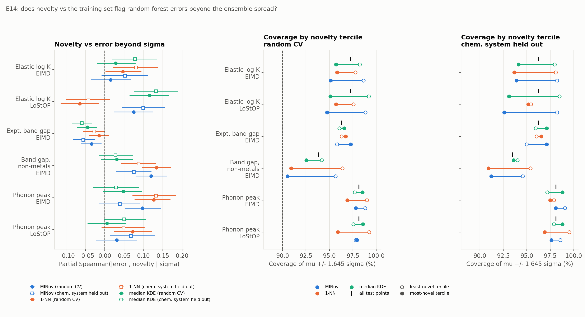
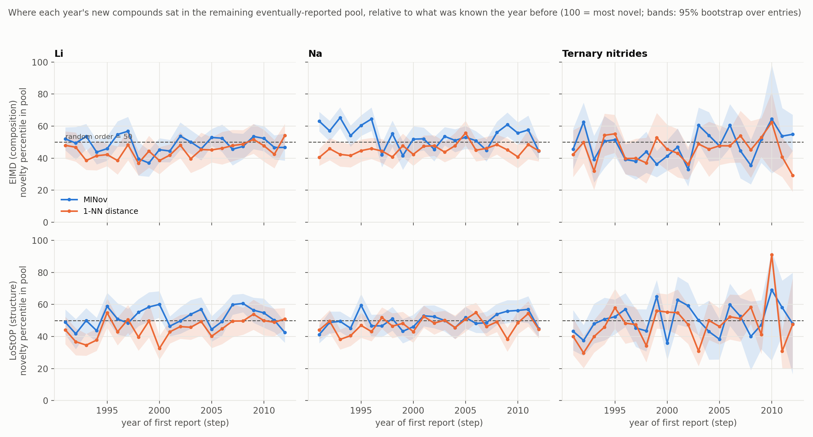

# Uncertainty in reference-relative novelty: experiment write-up

Branch `uncertainty-experiments`. Every headline number below was recomputed independently from the scripts' outputs or from the raw distance matrices. Scope: Li-containing compounds, with the core forward test, the margin band and the history replay replicated on Na compounds and ternary nitrides (sections 4, 6, 8), and a model-error test on three matbench/matminer property datasets (section 7).

## Bottom line

Novelty is always relative to a reference set, and reference sets are incomplete. The simplest defensible contribution is to measure how much an incomplete reference can change novelty calls, and to report novelty with that uncertainty attached:

1. **Which database counts as "known" is the largest source of novelty uncertainty.** Swapping the reference from experimental MP-2023 to another plausible choice (adding MP-2025's new entries, adding other GNoME predictions, or including MP's theoretical entries) changed **28–41%** of MINov's composition (ElMD) calls on GNoME candidates. That is **25–36×** the change caused by 30 years of reference growth. Size-matched controls give the same rates, so it is the content of the reference, not its size. Every score is affected (1-NN 23–57%, median-bandwidth KDE 8–18%). MINov's *ranking* mostly holds (Spearman 0.75–0.93); its *calls* move because the 5% threshold is set by the reference's own members, and the median GNoME candidate sits almost exactly on it. Structure (LoStOP) calls are much less sensitive (MINov 1.9–2.2%, 1-NN 13–14%). Any novelty claim should name its reference database (E15).
2. **MINov's novelty calls hold up when the reference grows.** Novelty was scored against the experimental Li compounds known in 2000 and then against the full record. MINov's novel/not-novel call changed for **0.7–2.4%** of candidates. Nearest-neighbour novelty, the form most used in the field, changed for **2.5–10.4%**: about **15× more often** for real later discoveries under ElMD. MINov changes less often than 1-NN in all 36 combinations of chemistry (Li, Na, ternary nitrides), split year, candidate pool and distance. The margin narrows for GNoME candidates under ElMD in Na and nitrides (1.2–1.4×). MINov is not the most stable score: the median-bandwidth Gaussian KDE flips less, especially for Na and nitride ElMD.
3. **Exact-match novelty ("not in the reference") is stable to reference growth because it only registers identical compounds.** Matching by composition or by structure (StructureMatcher, as used in S.U.N. benchmarks) answers a narrower question, "has this exact compound been reported?", and does not respond when close analogues are added. It never flipped in the forward test, partly by design: no GNoME formula is in experimental MP, and later discoveries' same-formula siblings were removed. With those siblings kept, composition match flips for 4.8–8.2%. Its apparent stability reflects low resolution, not robustness, and its real uncertainty lies elsewhere:
   - A 2× change in matcher tolerance alone almost doubles the number of structure matches.
   - The choice of reference database matters even more.
   - The species-agnostic "prototype" version (substitution-based novelty) is the most fragile measure tested: 19.5–25% of later discoveries flipped across the three chemistries.
4. **The usual way of estimating uncertainty is overconfident.** Nominal 90% rank intervals from random reference subsampling contained the realized future rank only **11–86%** of the time. Fine ranks are not meaningful at scale: 88–91% of adjacent MINov ranks swap if a single reference material is removed. Report calls and coarse tiers, not ranks.
5. **A simple margin band labels which calls are reliable as the reference grows, but not across reference choices.** Mark a call "uncertain" when the candidate's score lies within a few percentile points of the 5% threshold (calibrated on Li, Y = 2000: 1.26 points for MINov, 2.49 for KDE). Applied to other split years and chemistries, confident calls then flipped ≤ 1% in 23/32 test cells for MINov (every Na and Li 2005 cell) with 6% of calls labelled uncertain, and in 29/32 for KDE with 10%. 1-NN needs 30–40% uncertain and can never make a confident novel call. The band fails where the reference was small (ternary nitrides at 1990/2000, 383–687 entries), where later additions filled sparse regions and the threshold rose 3.9×. It catches only 7–9% of the call changes caused by switching reference database (E13, E15b).
6. **Global and local novelty are different quantities, and kernel width decides which one you measure.** MINov's median cutoff gives a stable, global measure. Narrow kernels and nearest-neighbour distance are local, more sensitive and less stable. No single width gives both.
7. **Analogue vacancy characterises how a generator's novelty differs.** GNoME candidates sit in substitution families that experiment has not explored. They are about 100× more "vacant" than real later discoveries (AUC 0.96 vs MP). This holds with either reference, but vacancy does not predict where experiments go next.

A side result on how discovery actually proceeded (E16): each year's new compounds sat slightly closer to their nearest known neighbour than the rest of what was eventually found (1-NN percentile 45–48, 50 = random), but at average global density under MINov (48–54). The field filled in locally without avoiding sparse regions globally, and found new stoichiometry types more slowly than a random order of the same compounds.

Five ideas failed and are dropped:
- **Plausibility-weighted de-novelling ("P(stays novel)"):** no better than the plain density margin.
- **Removal fragility as a forecast:** it did not predict which ranks actually changed, because the future adds materials, and a removal analysis cannot see that direction.
- **Abramson adaptive bandwidth:** it moved MINov along the existing trade-off rather than past it, and made ElMD calls flip about 4× more often.
- **Threshold rarefaction as an early warning:** thinning the reference at random just scales sum-type thresholds with size, so it cannot see the sparse regions later additions fill. Reference size alone flags the failing cells as well (E13b).
- **Novelty as a model-error signal beyond ensemble spread:** for random forests on three property datasets, novelty added at most +0.13 partial correlation with absolute error beyond the tree spread, never improved detection of the worst 10% of errors, and only slightly lowered interval coverage in the most novel tercile (E14).

## Data

- **Reference:** Materials Project v2023.11.1 (AWS Open Data, `materialsproject-build`), Li-containing, non-deprecated entries.
  - R23 = 2,095 experimental (ICSD-tagged) entries, all polymorphs.
  - Each entry gets a first-report year: the earliest literature year in MP provenance (median 1993, range 1916–2013).
- **Candidates:**
  - GNoME Li materials from the December 2023 release: a 3,000-sample for structure, all 16,762 formulas for formula-level analyses.
  - The 44 GNoME materials from the paper, used as a sanity check.
- **Year split:** reference = compounds first reported up to Y; "later" = those reported after Y. Y = 2000, with 1990 and 2005 as robustness checks.
  - MP itself added only 4 experimental Li entries between 2023 and 2025; nearly all its growth was GNoME imports tagged as theoretical. A comparison between MP releases was therefore not usable.
- **Distances:** LoStOP (structure) and ElMD (composition). The rebuilt matrices reproduce the published ones to 1e-7 and 1.6e-4 respectively.
- **Scores compared:**
  - MINov (exact, and the published grid)
  - the paper's KDE and kNN baselines, reimplemented to match `methods_analysis.ipynb`
  - Gaussian KDE and kNN width sweeps
  - 1-NN and 5-NN distance
  - LOF
  - a compressed MI kernel (cutoff at the q-quantile instead of the median)

A useful identity: for a symmetric distance matrix the MI profile equals the binary entropy of the fraction of reference pairs within distance t. The MI cutoff is therefore always the median pair distance, and MINov's weight 1 − H(F(d)) falls to half at the 11th percentile of pair distances.

## Results

### 1. How stable is novelty when the reference changes? (E1, E1b, E4, E7)

| Perturbation | MINov | Nearest-neighbour (1-NN) | Note |
|---|---|---|---|
| Random 90% removal: rank correlation with the full reference (E1) | 0.97–0.98 | 0.50–0.64 | Median-bandwidth Gaussian KDE: 0.99 |
| Additions needed to de-novel a novel candidate (E2) | median 42 (ElMD) | 1 | Closed form for MINov |
| Certified removals to flip a call (E4/E7, 3,000 candidates) | median 127 (ElMD) / 407 (LoStOP) | 36 / 42 | Greedy with refit; upper bounds |
| **Realized call flips, 2000 → full record (E7)** | **0.7–2.4%** | **2.5–10.4%** | GNoME: 1.1% vs 5.6% (ElMD), 0.8% vs 2.5% (LoStOP). Later discoveries: 0.7% vs 10.4%, 2.4% vs 5.6% |
| Nominal 90% rank-interval coverage of the realized rank (E7) | 0.35–0.86 | 0.42–0.55 | Median-bandwidth KDE: 0.11–0.41 |

*Figure 1. Left: share of candidates whose novel/not-novel call changed when the reference grew from the compounds known in 2000 to the full experimental record. Right: how often the nominal 90% rank interval from random reference subsampling contained the rank the candidate actually ended up with. The dashed line marks the nominal 90%.*

**Fine ranks are not robust:**
- **Swaps:** 88–91% of adjacent MINov rank pairs swap with a single removal, at 3,000 candidates.
- **Tiers:** of the two ways of grouping ranks into tiers, overlapping intervals chain into 4–5 blocks; walking down the ranking gives about 50 usable tiers.
- **What predicts movement:** the width of the random-subsampling interval does predict which ranks move (ρ ≈ 0.5). Removal fragility predicts it only weakly (ρ 0.07–0.26), because realized change comes from additions.

### 2. Global vs local novelty (E1b, E5, E9)

- **The trade-off:**
  - All scores lie on one stability–sensitivity frontier ordered by kernel width.
  - MINov sits at the stable, global end. It barely registers when a material's 20 nearest neighbours are removed (Δ ≈ 0.03 in novelty percentile).
  - Narrow kernels register such local holes, at a cost in stability.
- **Synthetic data with known density:**
  - Narrower kernels are more accurate (Spearman with the true density 0.97–0.99, vs 0.85–0.92 for MINov).
  - A compressed MI kernel (q ≈ 0.15) matches the best KDE there, but the advantage did not carry over to real ElMD data.
  - No ground-truth-free rule picks the width reliably.
- **Year split:**
  - Compounds reported after Y are scored as more novel than those already known by 1-NN and narrow kernels (AUC ≈ 0.70), but not by MINov (0.46–0.53).
  - Caution: "reported later" means newer, not chemically or structurally novel. This shows that later compounds sit slightly farther from their single nearest known neighbour, a local property. It does not show they are globally novel, and it is not evidence against MINov as a global measure.
- **Two-scale score:**
  - Rank-averaging MINov with a narrow MI kernel beats the stability–sensitivity frontier on both the original and the larger reference (+0.02 to +0.06 stability at equal sensitivity, CIs exclude 0, except 100-NN holes in ElMD).
  - It adds a second width and a mixing weight. Treat it as a diagnostic rather than a recommended method.

*Figure 2. Each point on the grey curve is an MI kernel of a different width, from narrow (left) to MINov's median cutoff (right). Top: sensitivity to a local gap (how much a compound's novelty rises when its 20 nearest neighbours are removed). Bottom: how well the score separates compounds reported after 2000 from those already known (0.5 = chance). This measures newness and local isolation, not global novelty. Wider kernels are more stable and less locally sensitive.*

### 3. Analogue vacancy (E6, E8)

V = log((E + 0.5)/(O + 0.5)). E is how many of a material's plausible substitution analogues (Hautier-style odds) the calibration expects to be present in the reference; O is how many actually are. Higher V means more vacant.

| Comparison | AUC [95% CI] |
|---|---|
| GNoME (16,762 formulas) vs MP, experimental reference | 0.959 [0.955, 0.962] |
| Same, reference includes theoretical MP entries | 0.954 [0.952, 0.957] |
| Compounds reported after Y vs before (Y = 1990 / 2000 / 2005) | 0.73 / 0.71 / 0.69 |
| GNoME vs real later discoveries | 0.92 |
| Vacancy at Y predicts an analogue being reported later | 0.35 (reversed: populated families fill, vacant families stay vacant) |

*Figure 3 (from E6, the 44 published GNoME candidates). Analogue vacancy against MINov density for MP compounds (grey, leave-one-out) and GNoME candidates (blue). Vacancy separates GNoME from MP along an axis density does not capture. Right: in the falsification test, MP split against itself (grey) sits at AUC 0.5, while GNoME (blue) sits near 0.93.*

- **Robustness:** vacancy survives cross-fitting, controls for analogue count and number of elements, removing f-block elements, and a falsification test (MP split against itself: AUC 0.50).
- **What it measures:** departure from explored chemical families. That is a useful way to characterise a generator's output. It is not a predictor of discovery.

### 4. Exact-match novelty and two more chemistries (E10, E12)

The forward test was repeated for exact-match novelty and on two new chemistries built from the same MP and GNoME data: Na compounds (3,065 experimental references, 3,000 GNoME candidates) and ternary nitrides (three elements including N, no O/H/C; 798 references, 770 candidates).

*Figure 4. Share of candidates whose novelty call changed between the 2000 reference and the full record, by chemistry. Top: GNoME candidates. Bottom: compounds reported after 2000. Left and centre: density and nearest-neighbour scores. Right: exact match by composition, structure (StructureMatcher defaults) and prototype (species-agnostic structure type).*

- **Density vs nearest neighbour:**
  - MINov changes less often than 1-NN in every case.
  - The gap is large for later discoveries (Na ElMD: 0.5% vs 8.8%) but small for GNoME under ElMD in Na and nitrides (6.3% vs 8.5%, 7.9% vs 9.6%), where many candidates sit near the threshold.
  - The median-bandwidth Gaussian KDE is the most stable everywhere (≤ 1.8%).
- **Interval coverage:** nominal 90% intervals undercover in every chemistry (11–86% at Y = 2000).
- **Exact composition and structure match:**
  - Never changed for GNoME, because no GNoME formula appears in experimental MP.
  - For later discoveries the design removes their same-formula siblings from the future reference. With those siblings kept, composition match flips for 4.8–8.2% and structure match for up to 1.5%.
- **Matcher tolerance (Li):**
  - Halving or doubling all StructureMatcher tolerances changes the number of matching same-formula pairs from 40 to 56 to 103 (of 628).
  - Prototype-novelty rates move by up to 6 points.
  - For structure match, a 2× looser tolerance changes novelty about as much as 30 years of reference growth.
- **Prototype match:** flips for 1.3–7.1% of GNoME candidates and 19.5–25% of later discoveries. Discoveries arrive in families that share a structure type.

### 5. Reference choice (E15, E15b)

The Li candidates (3,000 GNoME) were scored against four references: A, experimental MP-2023 (2,095 entries, the baseline everywhere else); B, A plus the 2,360 entries MP-2025 added (largely GNoME imports, so the 372 candidates imported into MP-2025 were excluded); C, A plus a separate 3,000-sample of current GNoME; D, all 21,761 MP-2023 Li entries including theoretical ones (ElMD only). Size-matched controls draw a subset of B, C or D the size of A. The new code reproduces E7's calls on A exactly.

*Figure 5. Share of GNoME candidates whose novel/not-novel call changes when the reference is swapped from experimental MP-2023 to another database. "Size of A" bars use a random subset of the same size as A (mean of 10 draws, whiskers min–max). The right-most group in each panel is the change from 30 years of reference growth (E7), for scale.*

- **Content, not size:** the size-matched subsets change calls as often as the full references (MINov ElMD 34.7% vs 34.8% for B). Growing a reference of the same mix (subset → full) changes under 1%.
- **Direction:** adding B or C only turns novel into not novel (MINov ElMD: 915 and 1,235 such changes, none the other way). Adding MP's theoretical entries (D) does the opposite (796 not→novel vs 38), because the many polymorph entries raise the reference's own density and hence the threshold. About half of D's effect is polymorph multiplicity (formula-only version: MINov 13.9%).
- **Ranking vs calls:** MINov's order of candidates mostly holds (Spearman 0.93 / 0.75 / 0.88 for B / C / D under ElMD; 1-NN 0.56 / 0.22 / 0.91). Holding the number of novel calls fixed, only 6–14% of MINov's calls change; the rest is the threshold moving.
- **Why the threshold moves:** "novel" means "less dense than 95% of the reference's own members". The median GNoME candidate sits at the 5.7th percentile under A (ElMD), so any change in who the reference members are moves many candidates across the line.
- **Consensus:** of the 50.6% of candidates MINov calls novel under A (ElMD), only 6.5% are novel under all four references. Calling the top 10% of the candidate pool novel instead (no reference threshold) keeps 21% of MINov's set across all references, 72% of KDE's and 7% of 1-NN's.
- **Margin band (E13):** the growth-calibrated band contains only 7–9% of MINov's ElMD call changes from swapping references; covering 90% of them would need a band of 4–14 points, i.e. nearly every novel call.
- **Structure is more robust:** under LoStOP, MINov changes 1.9–2.2% of calls (1-NN 13–14%, KDE 1.3–1.4%), though few candidates are structurally novel to begin with (3.4% under A).

### 6. A margin band for reliable calls (E13, E13b)

The margin is a candidate's percentile among the reference's leave-one-out scores at year Y, minus 5 (negative = called novel). A call is "uncertain" if |margin| ≤ c. c was calibrated on Li, Y = 2000 to hold 90% of the calls that later flipped, and then tested on 32 cells (Li 1990/2005, Na and nitrides at 1990/2000/2005; GNoME and later-discovery pools; ElMD and LoStOP). Recomputed thresholds and calls match the stored E7/E12 ones exactly.

*Figure 6. Top: share of confident calls that flipped (filled; open = all calls with no band), with 95% CIs, against the 1% target. Bottom: share of calls labelled uncertain. Note the log-like scale on the top row.*

| Score | c (points) | Cells with confident flips ≤ 1% | Pooled confident flips | Calls labelled uncertain |
|---|---|---|---|---|
| MINov | 1.26 | 23/32 | 0.68% | 5.8% |
| Median-bandwidth KDE | 2.49 | 29/32 | 0.23% | 9.9% |
| 1-NN | 4.49 | 20/32 | 1.27% | 28.6% |

- **A pure flip-rate target does not work:** calibrating c so that confident calls flip ≤ 1% on Li 2000 gives c ≈ 0, because only about 1% flip there anyway.
- **Where it fails:** MINov in ternary nitrides at 1990 (ElMD 12–15% of confident calls flip) and 2000 (4%). These flips are not near the threshold: the reference doubled (383 → 798) and the 5% threshold rose 3.9× as later additions filled sparse regions.
- **1-NN:** the margin cannot fall below −5 points, so 1-NN's calibrated band covers almost every novel call. It can only make confident "not novel" calls.
- **Early warning (E13b):** thinning the reference at random makes MINov and KDE thresholds shrink almost exactly in proportion to size (elasticity 0.94–1.11), so the curve tracks size, not unexplored regions. It underpredicted the nitride 1990 jump (2.3× predicted, 3.9× realized). Reference size alone flags the failing cells as well (all failures had references under ~1,000 entries), but with three chemistries that is an observation, not a calibrated rule.

### 7. Novelty and model error (E14)

Random forests (300 trees, Magpie + LoStOP features) were trained in 5×5-fold CV on `elastic_tensor_2015` (log K_VRH, 1,181), `matbench_expt_gap` (4,604; also non-metals only, 2,154) and `matbench_phonons` (1,265). For each test point: absolute error, tree spread σ, and novelty against the training fold.

*Figure 7. Left: partial Spearman correlation of absolute error with novelty given σ (95% bootstrap CIs; filled = random CV, open = chemical system held out). Centre and right: coverage of μ ± 1.645σ in the least and most novel terciles.*

- **Beyond σ, novelty adds little:** partial Spearman at most +0.13 (σ alone: 0.43–0.89). Which score carries it depends on the dataset: MINov and KDE on elastic, 1-NN on phonons, tied on non-metal gaps.
- **Worst-error detection:** σ alone has AUC 0.86–0.95 for the worst 10% of errors. An equal-weight rank average with novelty lowers it (by 0.01–0.13); a cross-fitted logistic combination gains at most +0.004 (+0.017 with chemical systems held out).
- **Calibration:** in 2 of 4 datasets, the most novel tercile's 90% interval covers 3.5–5.6 points less than the least novel tercile's, but never below the nominal 90% because the tree-spread intervals over-cover.
- **Caveat:** a random forest's σ is conservative and tracks error well; a model with weaker uncertainty could leave more room for novelty.

### 8. Side result: how the field ordered its discoveries (E16)

This is question Q4 of the campaign design (`MINOV/CAMPAIGN_PILOT.md`). For each year t from 1991 to 2012, the reference is everything first reported up to t − 1 and the pool is everything first reported from t onward (i.e. only what was eventually reported). Each year's actual new entries get a novelty percentile within that pool (100 = most novel; a random order gives 50). It measures how history ordered what it found, not whether discoveries were globally novel.

*Figure 8. Where each year's new compounds sat within the remaining eventually-reported pool, relative to what was known the year before (50 = random order; bands: 95% bootstrap over entries).*

| Chemistry, Y = 1990 | MINov ElMD | 1-NN ElMD | MINov LoStOP | 1-NN LoStOP |
|---|---|---|---|---|
| Li (990 entries) | 48.7 [46.9, 50.4] | **44.8** [43.0, 46.6] | 51.5 [49.8, 53.2] | **45.2** [43.5, 47.0] |
| Na (1,477) | **53.9** [52.3, 55.3] | **45.3** [43.7, 46.7] | 49.7 [48.2, 51.1] | **47.1** [45.6, 48.5] |
| Ternary nitrides (379) | 47.7 [44.9, 50.5] | **45.6** [42.9, 48.5] | 49.9 [47.2, 52.7] | 46.1 [43.4, 48.7] |

- **Locally, discovery filled in near known compounds:** by 1-NN, each year's compounds sat closer to a known neighbour than the rest of the pool (45–48 across chemistries and split years; below 50 in 20 of 22 Li years under ElMD). Removing same-formula polymorphs changes this by at most 1 point.
- **Globally, it did not:** under MINov and median-bandwidth KDE, discoveries came from regions of average density (48–54). Na compositions even came from slightly sparser regions. MINov scored the real discoveries higher than 1-NN did in all 18 cells.
- **Coverage:** the real order found new stoichiometry types and new chemical systems more slowly than all 20 random orders of the same pool (Li and Na, Y = 1990 and 2000). By half the picks after 2000, history had found 49% of the new Li stoichiometry types; a random order found 57% and a farthest-neighbour order 85–89%.
- **Effect sizes are small** (2–5 percentile points) and single years are noisy. Stoichiometry type here is the anonymized formula, not a structure prototype.

### 9. What did not work

- **P(stays novel), from plausibility-weighted additions (E2, E7):**
  - Discriminated surviving novelty calls worse than the plain density margin in all 17 evaluable cells (e.g. AUC 0.72 vs 0.985).
  - The substitution-based existence calibration underpredicts survival for GNoME and overpredicts it for real discoveries.
- **Removal fragility as a forecast of future change (E7):** see section 1. It remains a useful measure of robustness, but not a forecast.
- **Coverage estimators (Good-Turing, Chao; E3):** predict random additions within ~2%, but underpredict the novelty of generated candidates 2–18×.
- **Abramson adaptive bandwidth (E11):**
  - Scaling each reference's kernel by (pilot density / geometric mean)^(−1/2), with MINov as the pilot, adds no tuned parameter.
  - But it only slides MINov along the existing trade-off, to about where a fixed q ≈ 0.3 kernel sits.
  - It never lands above the frontier (gap −0.004 to −0.014), and it raises ElMD call flips from about 1% to about 4%.
  - A fully local MINov is degenerate (every point gets the same density), so any useful local adaptation needs some pooling, and with it a choice.
- **Near-duplicates (E5):** did not explain nearest-neighbour instability. The low intrinsic dimension of the data (1.6–2.4) likely does.

## Related work: novelty metrics in use and their exposure to reference uncertainty

A literature survey (mostly abstracts and partial full texts; items marked [UV] are unverified) found that common novelty metrics are binary exact-match checks or nearest-neighbour distances. None reports uncertainty.

| Metric / work | Definition | Reference set | Uncertainty reported | Exposure, given our results |
|---|---|---|---|---|
| CDVAE, DiffCSP, FlowMM benchmarks | Novel if pymatgen StructureMatcher finds no match in the training set | MP-20 / MPTS-52; tolerances [UV] | None | Exact match depends on reference coverage and matcher tolerance; a small reference inflates novelty. |
| MatterGen S.U.N. (Zeni et al., Nature 2025) | Stable, unique, novel; novel = no match under an ordered/disordered matcher | MP + Alexandria (+ ICSD) [UV] | No interval | A "novel" compound was a known disordered 1971 phase in the training data (Juelsholt, Mater. Horiz. 2026). |
| LeMat-GenBench (Betala et al., 2025) | Fraction not found in the reference | LeMat-Bulk (~5M) | One reference swap | MatterGen novelty 83.1% → 70.5% from MP-20 to LeMat-Bulk; the only reference-sensitivity result found, with no interval. |
| Continuous novelty (Negishi et al., 2025) | Mean minimum distance to the training set (Magpie, AMD) | MP-20 | None | A 1-NN score: the form our results show flips several times more often as the reference grows. |
| Substitution-based novelty (Negishi & Walsh, 2026) | Duplicate / substitution-derived / new | MP-20 | Not reported | 81–92% of generated crystals are duplicate or substitution-derived; consistent with our vacancy results. |
| GNoME (Merchant et al., Nature 2023) | New entries on the convex hull | MP, OQMD, WBM, ICSD snapshots [UV] | Snapshot only | Count depends on snapshot completeness; audit found few candidates that are novel, credible and useful (Cheetham & Seshadri, Chem. Mater. 2024). |
| A-Lab (Szymanski et al., 2023) | Absent from the reference | Not examined | None | About two-thirds argued to be known disordered phases (Leeman et al., PRX Energy 2024). |
| DiSCoVeR (Baird, Diep & Sparks, Digital Discovery 2022) | Composition density (ElMD + DensMAP) as a novelty proxy | MP | None | A wide-kernel density: a global measure, so it is stable but insensitive to local gaps (section 2). |
| kNN-distance OOD scores (e.g. MOOD) | Distance to the training set as an OOD flag | Training set | No reference perturbation | Same 1-NN fragility. |

No work was found that reports removal or addition fragility, rank intervals, matcher-tolerance sweeps or reference-version intervals for any of these metrics.

## Limitations

- **Scope:** Li for most analyses; the core forward test is replicated on Na and ternary nitrides (the nitride later-discovery pool is small: 208 compounds at Y = 2000). The first-report year is a literature proxy, and "later" means newer, not necessarily novel.
- **GNoME removals:** 22–43% of December-2023 GNoME entries in each chemistry have since been removed from the release and have no structure, so they are excluded.
- **Ground truth:** there is none for global novelty in real data. The forward test validates robustness of calls, not whether they are correct.
- **Greedy counts:** removal counts are upper bounds.
- **Substitution model:** the analogue generator is element-level, ignores structure, and uses exact formula matching.
- **Coverage:** forward-test coverage is limited to MP's experimental record; GNoME's "future" there is narrow.
- **Reference choice (E15):** Li only, with four references. The 5% leave-one-out threshold makes "known" mean "as dense as the reference's own members", so part of the effect belongs to that calling rule rather than to the score.
- **Margin band (E13):** calibrated on one chemistry and year; the calibration rests on about 80 flips per score.
- **Model error (E14):** one model family (random forest) with a conservative σ, three datasets.

## Reproduce

1. `uv run python experiments/fetch_data.py` downloads ~3 GB of public data to `data/raw/` (git-ignored, no API key needed).
2. `uv run python experiments/build_li_sets.py` builds the Li sets and distance matrices in `data/raw/processed/` (~20 min).
3. Run the experiments with `uv run python experiments/<script>.py`:
   - on the original data: `e1_reference_stability`, `e1b_stability_sensitivity`, `e2_denovelling`, `e3_coverage`, `e4_rank_uncertainty`, `e5_kernel_shape`, `e6_analogue_vacancy`
   - on the rebuilt data: `e7_fragility_forward`, `e8_vacancy_forward`, `e9_two_scale_transfer`, `e10_exact_match`, `e11_abramson`
   - new chemistries: `build_chem_sets.py` builds the Na and ternary-nitride sets in `data/raw/processed_na/` and `processed_nitride/` (~25 min), then `e12_new_chemistries` runs the forward test on them
   - after E7 and E12: `e13_margin_rule`, then `e13b_rarefaction`; `e15_reference_choice`, then `e15b_consensus_margin`; `e16_history_replay`
   - `e14_model_error` downloads three small matminer datasets (~1.5 MB) to `data/raw/e14/`

Each takes 1–65 min. Results go to `experiments/results/`; figures are the `*.png` files there.

4. `uv run python experiments/make_report_figures.py` redraws Figures 1 and 2 from the E7 and E9 outputs.
